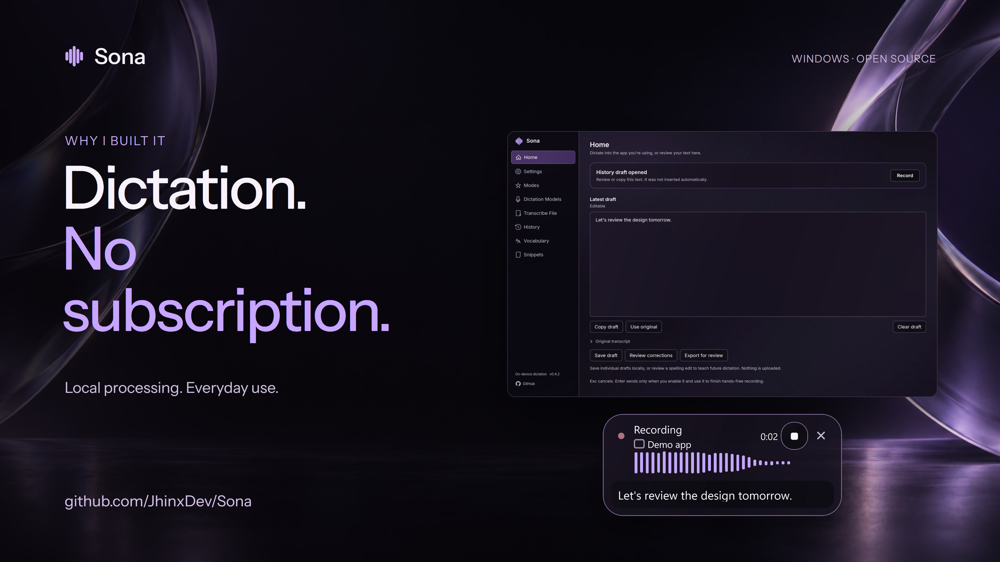
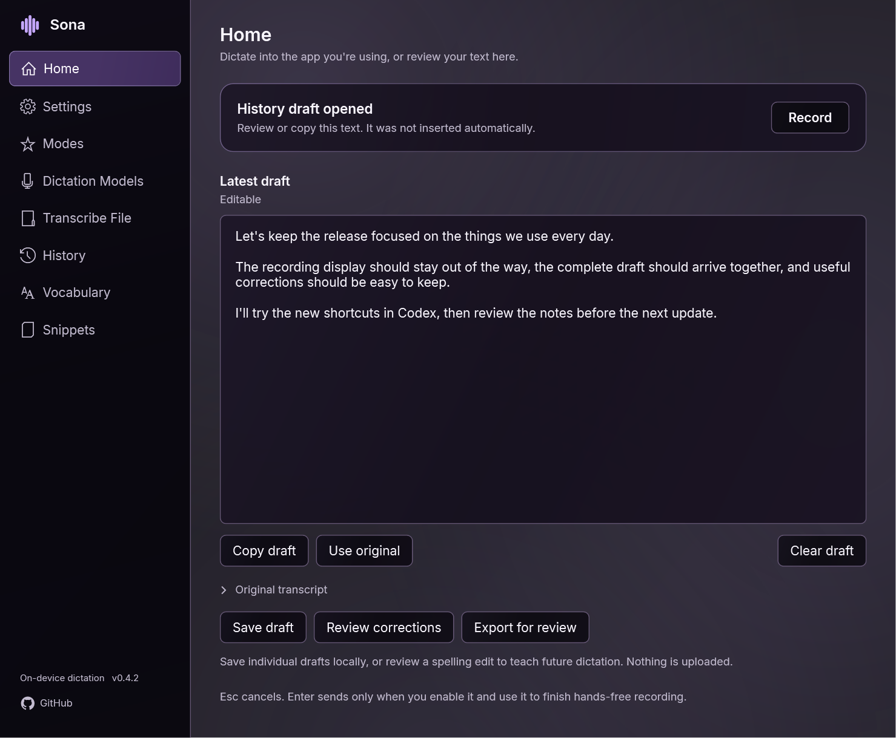
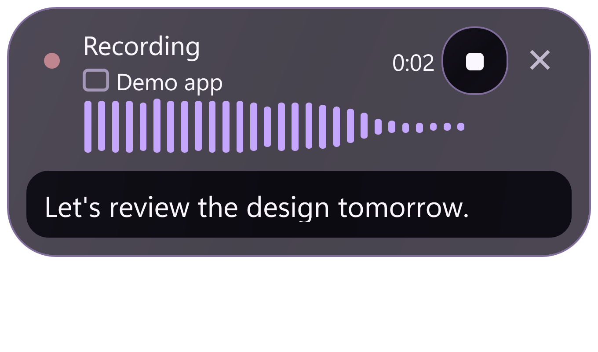
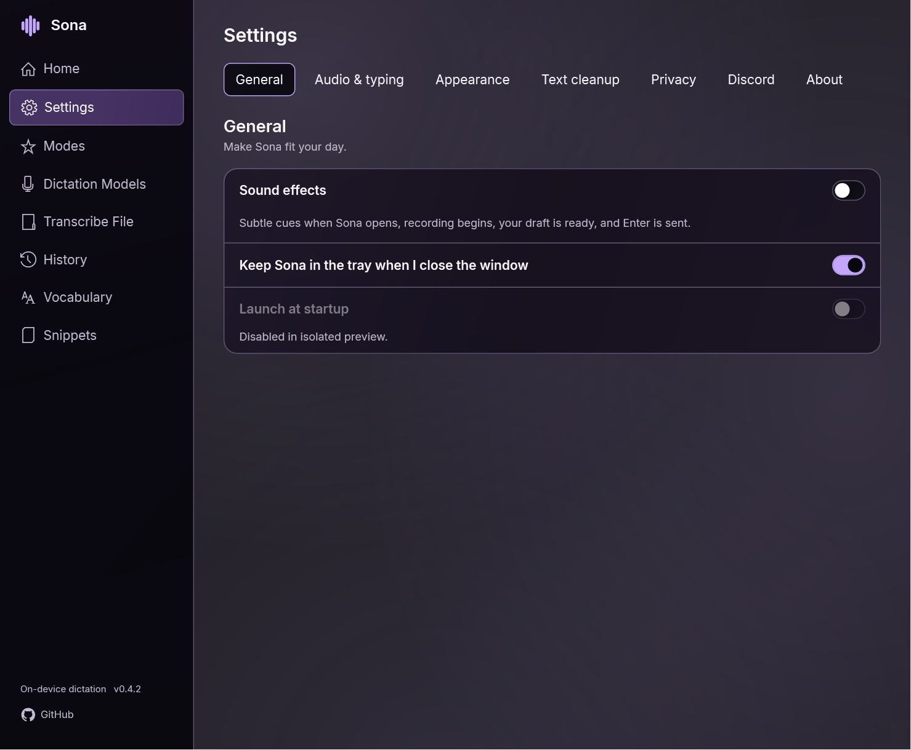
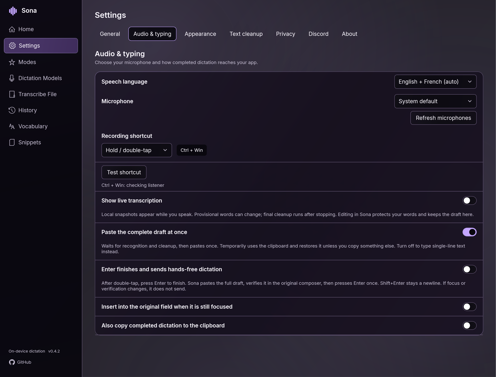
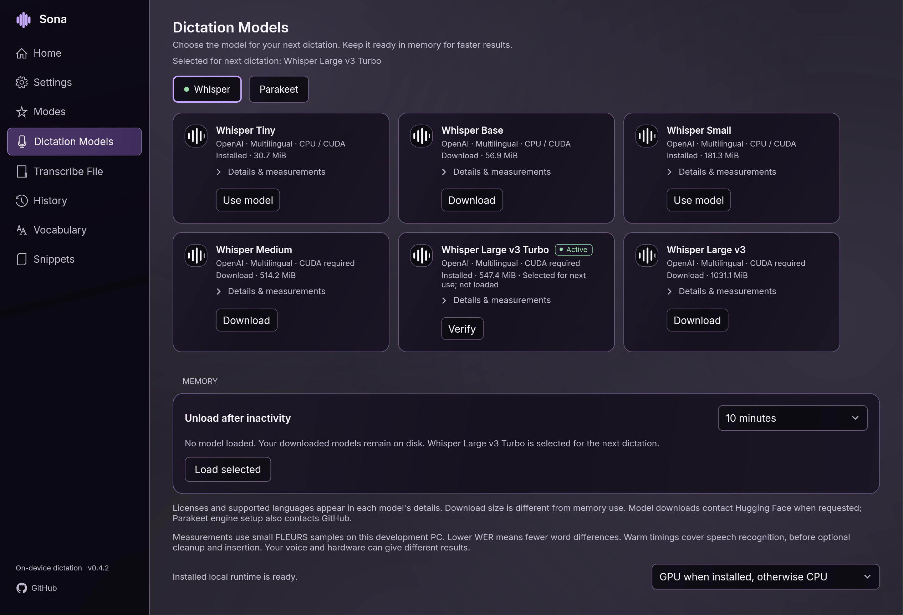

# Sona

**Local voice dictation for Windows. Your voice, your words, on your PC.**

Sona turns speech into text in your focused app using Parakeet or Whisper on
your own computer. Keep a model warm for quick reuse, polish wording locally,
add your vocabulary, and mute your Discord microphone while you dictate.
No Sona account or subscription is required.

It started with a frustration: subscriptions and quotas can make an everyday
dictation tool feel harder to use than it should. Sona is an early open-source
attempt at a native Windows alternative that you can inspect, adapt and improve.

**Early preview: 0.4.8.** Build from source below. There is no published binary
download yet. Feedback, bug reports, contributions and feature suggestions are
welcome.

[](https://www.youtube.com/watch?v=Xyz4TkNP58w)

**[Watch the updated 4K trailer on Jhinx Dev](https://www.youtube.com/watch?v=Xyz4TkNP58w).**
The trailer shows Sona 0.4.2 with actual app captures and a prerecorded local
recognition demonstration. The recording display replays measured speech and
transcript events; the receiving field illustrates insertion. It includes
AI-assisted narration, music and background art. [Capture details](docs/images/README.md).

## The app



These captures show the actual 0.4.2 WPF interface in Amethyst, rendered from
isolated demo profiles with synthetic text and no live microphone. The capsule
replays measured prerecorded speech through the actual UI. [Capture details](docs/images/README.md).

## New in 0.4.8

- Earlier Preparing feedback before call protection, the cue and microphone setup.
- A narrower recording capsule with readable themed hover help and a small cleanup
  button. Click to cycle **Off → Auto → Always → Off**; **A** means Auto.
- Optional Auto cleanup skips inference only for short, already formatted sentences.
  Uncertain text still uses the local model; the original transcript stays available.
- A completed live preview can supply the final result only when every captured
  byte is unchanged. New audio always receives final recognition.
- Recording can continue for five minutes. The limit keeps a draft for review and
  never automatically copies, pastes or sends it.
- With Enter-to-send enabled, Enter during transcription or cleanup queues sending
  after the entire draft is ready and the same composer is verified.
- Optional **Keep the draft on the clipboard if insertion fails** makes normal
  Ctrl+V available. A newer owner copy wins; cancellation restores owned clipboard
  changes. Check the composer before pasting after an unconfirmed request.

Existing profiles retain their cleanup choice; new profiles keep model cleanup,
Enter submission and clipboard recovery off until enabled. See
[responsiveness and delivery checks](docs/RESPONSIVENESS.md).

## New in 0.4.7

The two Discord protection switches apply and save immediately, with nearby
confirmation or failure guidance. Mute-only mode leaves incoming audio on;
incoming silencing can change during an existing recording. Paused state,
manual Discord changes and failed-operation retries remain protected.
[Settings behavior and isolated verification](docs/DISCORD-SETUP.md).

## New in 0.4.4

Clearer guidance when browser search suggestions hide the editable field from
Windows accessibility, plus a read-only report of the last intentional capture
in `sona-agent status`. Automatic insertion while a suggestion has accessibility
focus remains unsupported; use Copy draft and paste manually in that case.
[Observed limitation and verification](docs/DAILY-USE-AUDIT.md).

## New in 0.4.3

More precise retained-draft guidance, safer hosted-field capture, bounded model
preflight, reliable Quit after preparation errors, damaged-history preservation,
and protection for unsaved settings during agent patches.
[Audit and remaining owner check](docs/DAILY-USE-AUDIT.md).

## New in 0.4.2

- **Finish, then paste once.** Final recognition and cleanup complete before the
  whole draft reaches your original field. Optional Enter-to-send finishes
  hands-free recording and submits after verifying the inserted text.
- **Keep corrections that matter.** Save and export individual drafts; approve
  short spelling corrections as removable Vocabulary rules.
- **A quieter recording display.** A compact translucent capsule shows the app,
  a larger waveform and only the latest phrases, with no draft button or raw-text label.
- **Less hunting through settings.** Seven settings sections, compact Whisper and
  Parakeet cards, clear Discord connection controls and optional soft sound cues.
- **Manage growing history.** Browse by day and clear a chosen date range after
  reviewing its count. Explicitly saved drafts stay separate.

[Full changelog](CHANGELOG.md) · [Drafts, corrections and Enter-to-send](docs/PERSONALIZATION.md)



The capsule above is a native UI replay of measured prerecorded speech, using
actual recognition timing. It does not show a live microphone or chat submission.

## Everyday dictation

- **Hold Ctrl + Windows** to record, then release to finish. Double-tap the
  combination for hands-free recording and tap once to stop. Esc cancels.
  Sona inserts into compatible text fields while the original field remains
  focused. By default you review and send yourself. Optionally enable
  **Enter to finish and send**: during hands-free recording, your Enter gesture
  waits for the complete draft, pastes once, and submits only after the same
  composer exposes the full inserted text for verification.
- **Keep control of your words.** Home retains the original transcript and an
  editable result. A focus change preserves the draft instead of inserting it
  into a different field. Click the destination composer before recording;
  hovering over a chat does not select a text field. A retained-draft notice opens
  review/copy, and Ctrl+Alt+Shift+V inserts a ready draft into a newly focused field
  when that shortcut is available. Clipboard backup is optional. The recording display
  identifies the active app using its installed icon where available. A focus
  change during recording keeps the original destination and shows that the
  draft will stay in Sona.
- **See a live draft.** Enable Show live transcription in Settings and save.
  Local audio snapshots update provisional text every few seconds while you speak.
  Final recognition and optional cleanup run after stopping. Open Home to edit;
  your edits stay protected and the final cleaned suggestion remains separate.
  Partial text is never automatically typed into another app.
- **Hear subtle feedback.** Original short cues mark opening, recording start, a ready draft and an explicit Enter submission. Turn Sound effects off under Settings → General.
- **Keep useful drafts.** Save original, generated and corrected text locally,
  reopen it in History, or export one draft for review. Approve a proposed spelling
  correction to teach a removable Vocabulary rule. This does not train the speech model.
  History groups recent dictations by day, with Today, Last 7 days, Last 30 days
  and specific-day filters. Clearing recent entries preserves explicitly saved drafts.
- **Choose local recognition.** NVIDIA Parakeet v3 and six Whisper models
  offer CPU or NVIDIA CUDA options. Explicit downloads use pinned sizes and
  hashes. Compact cards are grouped under Whisper and Parakeet, with a green
  indicator on the selected family. Selected and actually loaded models are shown separately.
- **Keep models ready.** One speech worker stays resident for the configured
  idle timeout, until a switch, explicit unload or quit. Keep until quit is
  available; unloading keeps the downloads.
- **Polish locally.** Optional Spokenly Cleanup 1 handles punctuation, fillers,
  repetition and spoken corrections with Polished, Casual or Lowercase styles.
  It has separate CPU/GPU and idle controls. Verbatim and exact snippets bypass
  the model; your original transcript remains available.
- **Add your vocabulary.** Recognition hints, corrections and snippets help
  with project names, terminology and recurring text.
- **Keep dictation out of Discord calls.** Optional protection mutes your microphone while
  Sona or a watched ChatGPT/Codex app records, so others do not hear your
  dictation. Incoming audio can also be silenced. Overlapping recordings share
  protection, and restoration respects manual mute/deafen choices. Settings shows
  the connection state and explicit Connect/Disconnect actions. No separate bot
  runs alongside Sona; [Discord setup and eligibility](docs/DISCORD-SETUP.md)
  explain the required developer application and consent.
- **Fit your workspace.** Eight light/dark glass themes, Inter typography, Panel or
  Capsule recording displays, microphone level bars and local WAV transcription.
- **Connect your tools.** A JSON CLI and stdio MCP interface manage status,
  validated settings, models and call protection without remote microphone control.

Glass is the shared style across all eight themes. Choose **Settings → Appearance →
Amethyst** for near-black smoked violet surfaces and soft lilac edges, or choose
Charcoal, Fjord, Mocha, OLED, Paper, Linen or Mist for the same material in another
palette. Supported Windows 11 systems use Mica when transparency is enabled;
opaque and system high-contrast fallbacks preserve readability. Saved Amethyst Glass
settings map to Amethyst. New profiles still start with Charcoal.

<details>
<summary>Explore the updated settings and model cards</summary>







</details>

## Build and run

You need Windows x64 and PowerShell. The native UI is verified on Windows 11 x64.
A microphone is needed for live dictation. macOS and Linux desktop ports are not
available yet.
Initial SDK, NuGet, engine and model downloads need internet access. The setup
script below provisions the pinned .NET 8 SDK, Whisper CPU engine and Small
model into a directory you choose.

Clone the repository, then run these commands from its root:

```powershell
git clone https://github.com/JhinxDev/Sona.git
cd Sona

$env:SONA_RUNTIME = Join-Path $env:LOCALAPPDATA 'Sona\runtime'
.\tools\setup-runtime.ps1 -RuntimeRoot $env:SONA_RUNTIME -BuildTools
$env:DOTNET_ROOT = Join-Path $env:SONA_RUNTIME 'sdk'
$env:DOTNET_CLI_HOME = Join-Path $env:SONA_RUNTIME 'dotnet-home'
$env:NUGET_PACKAGES = Join-Path $env:SONA_RUNTIME 'nuget'
$env:DOTNET_CLI_TELEMETRY_OPTOUT = '1'
$sonaDotnet = Join-Path $env:SONA_RUNTIME 'sdk\dotnet.exe'

& $sonaDotnet build .\src\Sona.App\Sona.App.csproj -c Release --disable-build-servers -p:UseSharedCompilation=false
& $sonaDotnet build .\src\Sona.Agent\Sona.Agent.csproj -c Release --disable-build-servers -p:UseSharedCompilation=false
& .\src\Sona.App\bin\Release\net8.0-windows\Sona.exe
```

Keep `SONA_RUNTIME` set when launching this source build so Sona finds these
assets. Source projects, namespaces and assets use the Sona name. Existing private
profiles are reused without moving settings or encrypted credentials; new profiles
use `%LOCALAPPDATA%\Sona`. `SONA_DATA` selects an isolated test profile; the old
environment alias remains supported for earlier tooling.

If a preview window has an empty client area, launch `Sona.exe --software-rendering`
to use the optional software renderer. The microphone-disabled `--test-ui` mode
uses it automatically, requires a separate `SONA_DATA` directory, and opens its
window offscreen without activation so automated checks do not interrupt desktop use.

In **Dictation Models**, choose **Download** for Parakeet v3, then **Use model**.
Its CPU or CUDA runtime is installed explicitly when needed. For CPU execution,
choose **CPU only** and save model preferences before downloading. CUDA requires a compatible NVIDIA
driver; Sona does not install a driver or global CUDA toolkit. Whisper CUDA
uses a separate setup script:

```powershell
.\tools\setup-cuda-runtime.ps1 -RuntimeRoot $env:SONA_RUNTIME
```

In **Settings → Text cleanup**, set up the selected backend, enable cleanup and
save preferences. See [cleanup setup](docs/LOCAL-CLEANUP.md) and
[model details](docs/PARAKEET.md).

## CLI and MCP

With Sona running, use the CLI built above:

```powershell
$sonaAgent = '.\src\Sona.Agent\bin\Release\net8.0-windows\sona-agent.exe'
& $sonaAgent status
& $sonaAgent models list
& $sonaAgent cleanup status
& $sonaAgent protection status
```

Use the absolute path of `sona-agent.exe` with `--mcp` in an MCP-capable client.
The desktop connection is a current-user-only named pipe; MCP runs over stdio.
The interface does not expose credentials, transcript export or microphone-start
  commands. [Commands and MCP configuration](docs/AGENT-INTERFACE.md).

## Privacy and preview limits

Speech recognition and text cleanup run locally. Model/runtime downloads,
optional GitHub update checks and an enabled Discord connection use the network.
Cloud speech, sign-in, sync and analytics are not implemented.

Startup, saved transcript history, clipboard backup, local model cleanup,
Discord protection and update checking start disabled on new profiles.
Optional local history is capped at 200 text entries and stores no audio.

Recordings are bounded to five minutes and speech requests to 90 seconds.
A duration-limit stop retains a draft without automatic copy, insertion or submission.
Long Parakeet recordings use independent segments of at most 25 seconds.
File transcription accepts short 16 kHz mono PCM WAVs. Medium, Turbo and Large
Whisper require the separately installed CUDA engine. Cleanup is limited to
4000 input characters and a 20-second inference deadline; model loading has
separate limits. Cleanup can change meaning despite preservation checks, so
review your result and use the original when needed.

On one RTX 4080 SUPER, eight English clips gave Parakeet v3 5.13% word error
rate and a 21 ms median warm speech request, versus Whisper Turbo's 5.77% and
144 ms. This small licensed fixture excludes recording, cleanup and insertion;
it does not predict your voice or end-to-end delay. The pinned Whisper CUDA
runtime also crashed in a mixed English/French resident sequence. Personal
microphone and target-app acceptance for the new Parakeet integration remain
open. [Measurements and known limits](docs/PARAKEET.md).

Discord protection currently supports Discord only and requires your own
authorized Discord developer application setup. Sona ships no shared credentials.
Connect and enable it in Settings. If another app controls Discord muting, pause
that app first so both do not change the same call state.

## Contributing

Try it on your hardware and tell us what works, what fails, and what would make
dictation more useful. Include your Windows version, selected model/backend and
steps to reproduce a bug. Keep private transcripts and credentials out of reports.

For the maintained regression checks, from the same PowerShell session:

```powershell
& $sonaDotnet run --project .\tests\Sona.Tests -c Release --disable-build-servers -p:UseSharedCompilation=false
& $sonaDotnet run --project .\tests\Sona.WindowsTests -c Release --disable-build-servers -p:UseSharedCompilation=false
```

The owner confirmed real hands-free Enter-to-send in Codex on the final 0.4.2
build on October 15, 2026. That is one target-app smoke test; the automated checks
do not establish broad microphone, other-app or live-call acceptance. [Preview validation](docs/PREVIEW-VALIDATION.md) ·
[Contributing](CONTRIBUTING.md) · [Verification](docs/VERIFICATION.md) ·
[Design](docs/DESIGN.md) · [Implementation](docs/IMPLEMENTATION.md) ·
[Alternatives](docs/ALTERNATIVES.md)

## License

Sona's original source is [MIT licensed](LICENSE). Engines, models, fonts and
redistributables retain their own terms, including Parakeet's CC-BY-4.0 weights.
The bundled Parakeet scheduler repair includes its source patch, rebuild
instructions and license notices. [Third-party notices](THIRD-PARTY-NOTICES.md).

## History controls

Use **Pause history** on History to stop adding new entries while continuing
dictation; **Resume history** starts future entries again. The choice is remembered
across restarts. Existing entries remain until you clear or delete them. **Clear
recent** previews the selected range/search and requires its confirmation; saved
drafts and your working editor stay. **Delete draft** removes an individual row.
[Details](docs/HISTORY-CONTROLS.md).
