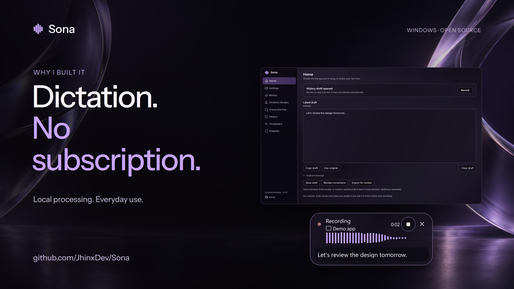
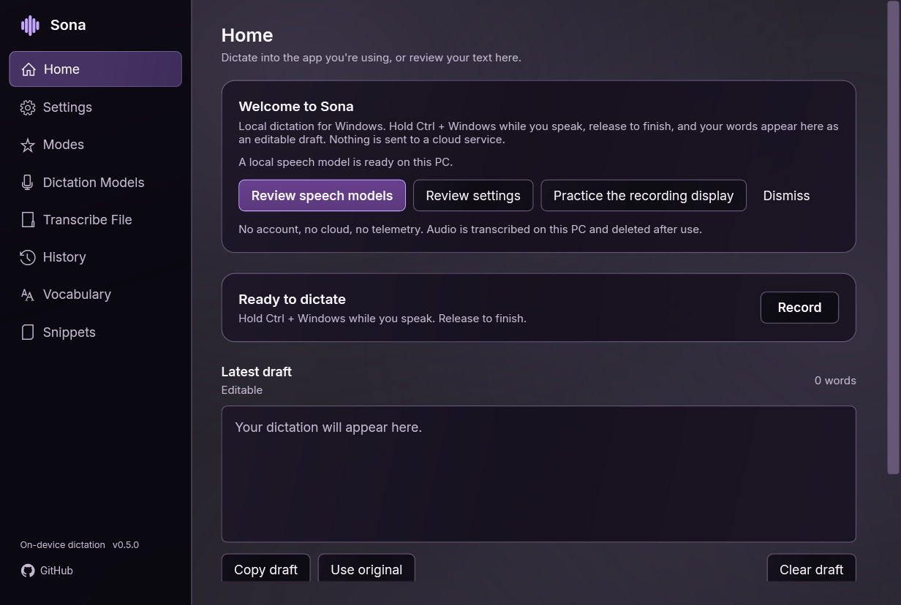
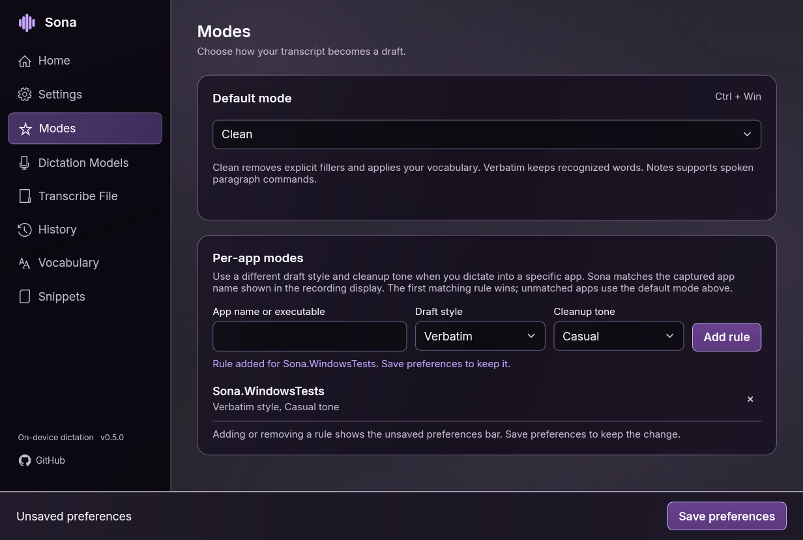
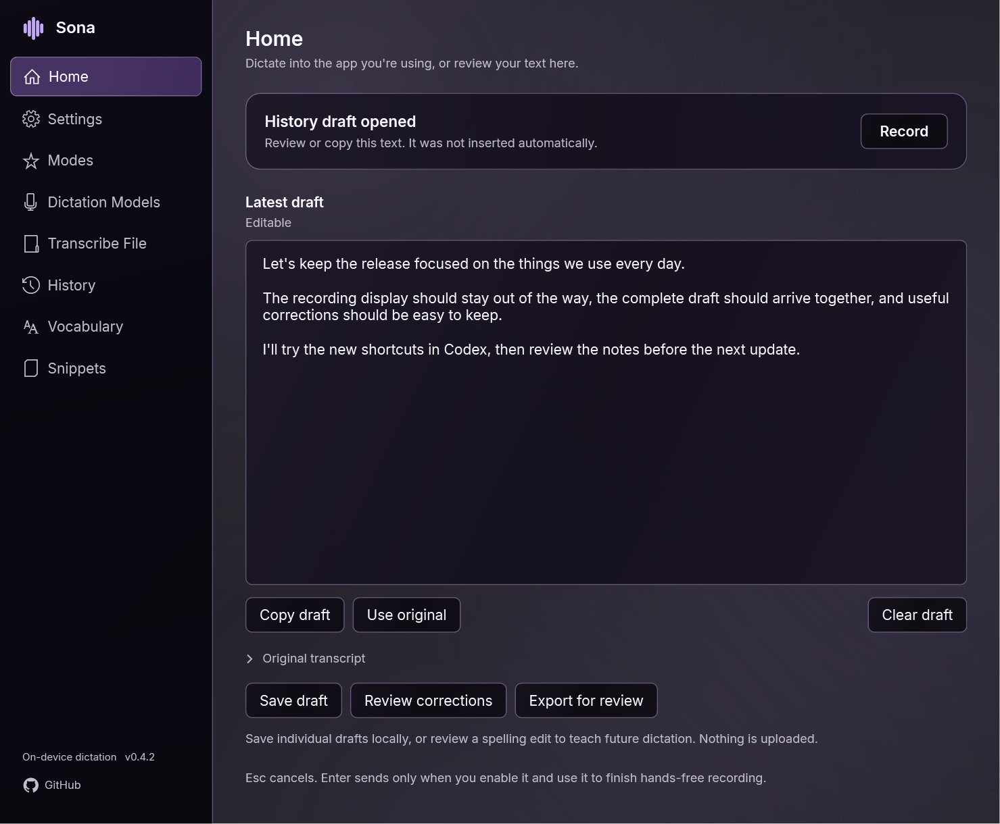
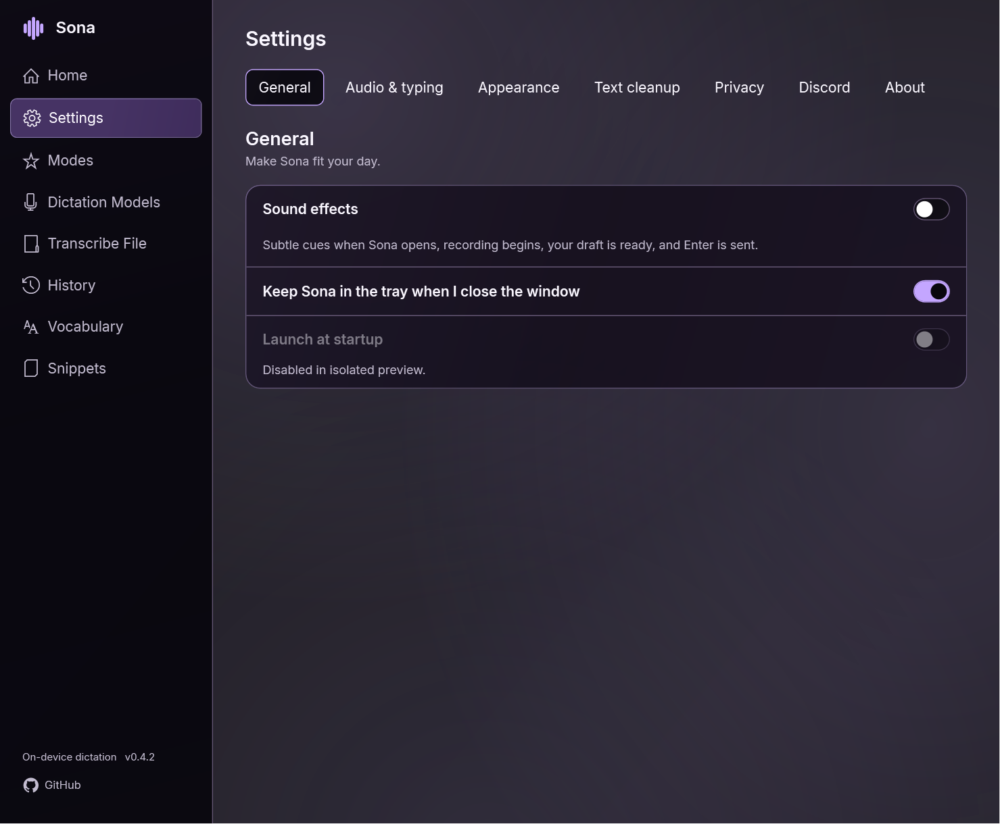
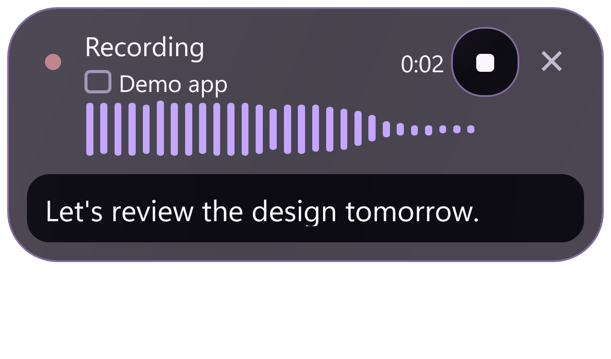
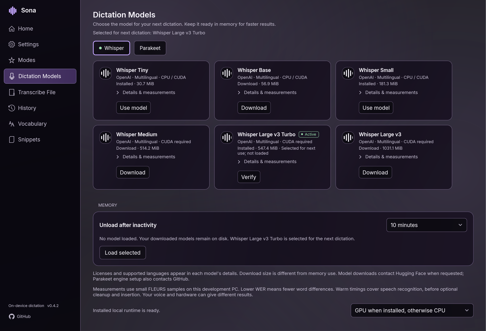

# Sona

**Local voice dictation for Windows. Your voice, your words, on your PC.**

Sona turns speech into text in your focused app using Parakeet or Whisper on
your own computer. Keep a model warm for quick reuse, polish wording locally,
add your vocabulary, keep a reviewable draft, and mute your Discord microphone
while you dictate. No Sona account, no subscription and no cloud speech service.

**[Download Sona for Windows x64](https://github.com/JhinxDev/Sona/releases/download/v0.5.6/Sona-Setup-0.5.6.exe)**

The published Windows installer is **v0.5.6**, an unsigned early preview.
[Release notes](https://github.com/JhinxDev/Sona/releases/tag/v0.5.6) ·
[SHA-256 checksums](https://github.com/JhinxDev/Sona/releases/download/v0.5.6/SHA256SUMS.txt)

See the [install guide](docs/INSTALL.md) for first-run setup and uninstall
instructions. Build-from-source instructions are below.

[](https://www.youtube.com/watch?v=Xyz4TkNP58w)

The updated 4K trailer on [Jhinx Dev](https://www.youtube.com/watch?v=Xyz4TkNP58w)
shows Sona 0.4.2 with actual app captures and a prerecorded local recognition
demonstration. The recording display replays measured speech and transcript
events; the receiving field illustrates insertion. It includes AI-assisted
narration, music and background art. [Capture details](docs/images/README.md).

## Install on Windows

Use the [published Windows installer](https://github.com/JhinxDev/Sona/releases/tag/v0.5.6),
or compile the current source with `tools/installer/build-installer.ps1`. See
[installing Sona](docs/INSTALL.md) for requirements, first-run model steps,
uninstall behavior and the unsigned-preview warning. The installer is
self-contained (no separate .NET install), needs no administrator rights, and
bundles the pinned Whisper CPU engine; model weights are downloaded inside Sona
from the Dictation Models page. There is no macOS or Linux build: the app uses WPF
and Windows-only capture, hotkey, insertion and model-runtime APIs, so another
platform would be a separate native app rather than a repackage.

## New in 0.5.6

Sona can identify deeply embedded editors by the Windows handle of their
container. This helps hold-to-talk paste into the active Codex composer.
**Check the draft** asks you to look in the field when Sona has already
requested a paste and cannot verify the result.

## New in 0.5.5

Sona can briefly recheck the original composer when Windows accessibility
cannot identify it. After one paste, the recheck can verify the complete draft
in that field. If the field was temporarily unavailable during readback, review
the confirmed draft and send it yourself. [Delivery behavior](docs/ENTER-DELIVERY.md)

## New in 0.5.4

- Sona can verify a paste through a second Windows accessibility text view when
  the first stays stale or is unavailable. Enter-to-send still requires the
  complete draft in the same focused field.
- **Draft copied** means Sona kept the draft for manual paste without requesting
  one. If Sona requested a paste and could not verify the result, check the
  field before pasting again. [Delivery behavior](docs/ENTER-DELIVERY.md)

## New in 0.5.3

- **Loading feedback is real.** When a model genuinely loads, Sona names it and
  shows the actual stage and measured time, for example
  "Checking Whisper Large v3 Turbo files · 1.2 s · Esc cancels" then
  "Loading Whisper Large v3 Turbo · 2.8 s · Esc cancels". Warm dictation shows no
  preparation text, and a completed cold load reports its measured duration.
- **Measured load times on the model pages.** Dictation Models and Text cleanup
  show the last real load time. With **Keep until quit** selected they also say
  the model stays loaded until Sona quits.
- **Keep both models resident.** **Unload after inactivity → Keep until quit** is
  available for the speech model (Dictation Models) and the text-polish model
  (Text cleanup). Dictation then starts without a reload wait; Quit still releases
  both workers.
- **Residency settings save reliably.** Changing the Dictation Models idle choice
  while a model is warming now saves and applies immediately instead of being
  rejected.

## New in 0.5.2

Task Manager and Process Explorer now make Sona's background workers obvious:
**Sona Speech Engine** is the speech model process and **Sona Text Polish** is the
optional local cleanup model process, instead of upstream names such as
`whisper-server.exe` and `llama-server.exe`. The one-shot WAV worker appears as
**Sona Transcription**. These are byte-identical copies of the verified engines,
launched under clear names; the pinned originals remain untouched and keep their
integrity checks. Task Manager will show the new names after the workers next
start.

## New in 0.5.1

- **Dictation works while Discord is deafened.** Discord turns the microphone off
  when you deafen and refuses a separate mute command. Sona now treats a deafened
  call as microphone protection, keeps your deafen choice untouched, and records
  normally instead of stopping with "Discord did not acknowledge microphone
  protection."
- **More forgiving Discord acknowledgements.** If Discord answers with stale voice
  settings, Sona verifies the real state and retries once. A real failure now
  explains the next step: undeafen, reconnect in Settings, or turn call
  protection off to dictate.

## New in 0.5.0

- **Per-app modes.** Give a specific app its own draft style and cleanup tone.
  Dictate into Codex with Verbatim, into Discord with Casual tone, and keep
  everything else on your default mode. The first matching rule wins and is
  applied only to that dictation. See [modes](docs/MODES.md).
- **First-run guidance.** A new profile sees a short welcome card that explains
  the shortcut and local privacy promise, links to model and settings setup, and
  can be dismissed. If the local runtime or model is missing, Home shows the
  exact next step instead of a dead Record button.
- **A live draft word count** on Home, so long dictations are easy to size up.
- **Reliability repairs.** Esc cancellation now runs on its own listener thread
  so a busy interface cannot silently drop the cancel hook; a microphone that
  stalls while stopping keeps the audio captured so far instead of losing the
  dictation; a faulted stop or quit path can no longer strand the session or
  leave the window disabled; Windows startup registration is only changed from
  an installed build; and preferences, history and saved Discord setup are
  flushed to disk before atomic replacement.

## The app



The welcome card appears for a new profile and links directly to model, settings
and recording-display setup. Captures in this repository use isolated profiles
with synthetic text and no live microphone.



Per-app rules combine a draft style with a cleanup tone for one captured app
identity. Voice, audio and transcripts stay on this PC.

<details>
<summary>More interface captures</summary>









</details>

## What works

- **Hold Ctrl + Windows** in a focused text field while you speak. Release to
  paste the finished draft, then review and send it yourself. Double-tap for
  hands-free dictation and tap once to stop. Esc cancels.
- **Optional Enter-to-send.** During hands-free recording, Enter waits for the
  complete draft, pastes once, verifies the inserted text in the same composer,
  and only then submits. Focus, field identity and readback guard every step.
- **A reviewable draft by default.** Home keeps the original transcript and an
  editable result. A focus change preserves the draft instead of inserting it
  into a different field. A retained-draft notice opens review or copy, and
  optional clipboard recovery enables normal Ctrl+V after an unconfirmed paste.
- **Per-app modes.** Ordered rules map a captured app name, executable or package
  identity to a draft style (Clean, Verbatim, Notes) and a cleanup tone
  (Polished, Casual, Lowercase). Unmatched apps use the default mode.
- **Live transcription** (optional). Local audio snapshots update provisional
  text every few seconds. Final recognition and cleanup still run after stopping.
  Partial text is never typed into another app.
- **Local recognition choices.** NVIDIA Parakeet v3 and six Whisper models offer
  CPU or NVIDIA CUDA options. Downloads use pinned sizes and hashes. Selected and
  actually loaded models are shown separately, and one worker stays resident for
  the configured idle timeout.
- **Optional local cleanup.** Spokenly Cleanup 1 handles punctuation, fillers,
  repetition and spoken corrections with Polished, Casual or Lowercase styles.
  Verbatim and exact snippets bypass it, and the original transcript remains
  available.
- **Vocabulary and snippets.** Recognition hints, explicit spelling corrections
  and whole-utterance snippet expansion help with names, terminology and
  recurring text.
- **History and saved drafts.** Grouped by local day with search, date ranges,
  pause, clear and per-row delete. Saving history is opt-in, capped at 200 text
  entries, and stores no audio. Explicitly saved drafts stay separate.
- **Discord call protection** (optional). Mute your microphone while Sona or a
  watched app records, and optionally silence incoming audio. A call where you
  are already deafened counts as protected and is left untouched. Sona ships no
  shared credentials; you connect your own Discord application.
- **Workspace fit.** Eight light/dark glass themes, Inter typography, Panel or
  Capsule recording displays, a microphone picker and local WAV transcription.
- **Recognizable background workers.** Task Manager shows **Sona Speech Engine**,
  **Sona Transcription** and **Sona Text Polish** rather than upstream binary names.
- **Connect your tools.** A JSON CLI and stdio MCP interface expose status,
  validated settings, models and call protection, with no remote microphone
  control.

## Build and run

You need Windows x64 and PowerShell for the source build below; the installer needs
neither. The native UI is verified on Windows 11 x64. A microphone is needed for
live dictation. macOS and Linux are not supported: this codebase is WPF and Win32
native. Initial SDK, NuGet, engine and model downloads need internet
access. The setup script provisions the pinned .NET 8 SDK, Whisper CPU engine and
Small model into a directory you choose.

```powershell
git clone https://github.com/JhinxDev/Sona.git
cd Sona

$env:SONA_RUNTIME = Join-Path $env:LOCALAPPDATA 'Sona\runtime'
.\tools\setup-runtime.ps1 -RuntimeRoot $env:SONA_RUNTIME -BuildTools
$env:DOTNET_ROOT = Join-Path $env:SONA_RUNTIME 'sdk'
$env:DOTNET_CLI_HOME = Join-Path $env:SONA_RUNTIME 'dotnet-home'
$env:NUGET_PACKAGES = Join-Path $env:SONA_RUNTIME 'nuget'
$env:DOTNET_CLI_TELEMETRY_OPTOUT = '1'
$sonaDotnet = Join-Path $env:SONA_RUNTIME 'sdk\dotnet.exe'

& $sonaDotnet build .\src\Sona.App\Sona.App.csproj -c Release --disable-build-servers -p:UseSharedCompilation=false
& $sonaDotnet build .\src\Sona.Agent\Sona.Agent.csproj -c Release --disable-build-servers -p:UseSharedCompilation=false
& .\src\Sona.App\bin\Release\net8.0-windows\Sona.exe
```

Keep `SONA_RUNTIME` set when launching this source build so Sona finds these
assets. New profiles use `%LOCALAPPDATA%\Sona`; `SONA_DATA` selects an isolated
test profile. If a preview window has an empty client area, launch
`Sona.exe --software-rendering`. The microphone-disabled `--test-ui` mode
requires a separate `SONA_DATA` directory and opens its window offscreen without
activation.

In **Dictation Models**, choose **Download** for Parakeet v3, then **Use model**.
For CPU execution choose **CPU only** and save model preferences before
downloading. CUDA requires a compatible NVIDIA driver; Sona does not install a
driver or a global CUDA toolkit. Whisper CUDA uses a separate setup script:

```powershell
.\tools\setup-cuda-runtime.ps1 -RuntimeRoot $env:SONA_RUNTIME
```

In **Settings → Text cleanup**, set up the selected backend, enable cleanup and
save preferences. See [cleanup setup](docs/LOCAL-CLEANUP.md) and
[model details](docs/PARAKEET.md).

## CLI and MCP

With an installed Sona, `sona-agent.exe` is beside `Sona.exe`. With a source build,
use the CLI built above:

```powershell
$sonaAgent = '.\src\Sona.Agent\bin\Release\net8.0-windows\sona-agent.exe'
& $sonaAgent status
& $sonaAgent models list
& $sonaAgent cleanup status
& $sonaAgent protection status
```

Use the absolute path of `sona-agent.exe` with `--mcp` in an MCP-capable client.
The desktop connection is a current-user-only named pipe; MCP runs over stdio.
The interface does not expose credentials, transcript export or microphone-start
commands. [Commands and MCP configuration](docs/AGENT-INTERFACE.md).

## Privacy and network calls

Speech recognition, live preview, cleanup, history and drafts run locally. Sona
has no account, cloud speech, sync or analytics. It uses the network only in
these cases:

| Action | Endpoint | When |
| --- | --- | --- |
| Speech model download | Hugging Face model files | When you press Download |
| Parakeet engine setup | GitHub release assets | When you first use Parakeet |
| Cleanup model setup | Pinned model and runtime download | When you set up cleanup |
| Update check | GitHub public release metadata | Only when enabled in Settings |
| Discord protection | Discord voice gateway | Only after you connect it |

Startup, saved transcript history, clipboard recovery, local cleanup, Discord
protection and update checks all start disabled on a new profile. Optional local
history is capped at 200 text entries and stores no audio. Recordings are deleted
after transcription.

## Measured performance

On one RTX 4080 SUPER, eight English clips gave Parakeet v3 a 5.13% word error
rate and a 21 ms median warm speech request, versus Whisper Turbo's 5.77% and
144 ms. This small licensed fixture excludes recording, cleanup and insertion; it
does not predict your voice or end-to-end delay. The pinned Whisper CUDA runtime
also crashed in a mixed English/French resident sequence.
[Measurements and known limits](docs/PARAKEET.md).

## Known limitations

- Windows x64 only. A per-user installer is published on the Releases page, but
  it is not code-signed yet and the release is marked as an early pre-release.
- No macOS or Linux build. The native app depends on WPF and Windows-only capture,
  hotkey, insertion and model-runtime APIs; a port would be a separate project.
- Automatic insertion while a browser suggestion or list item has accessibility
  focus is unsupported. Sona keeps the draft and offers copy/paste guidance.
- Recordings are bounded to five minutes and speech requests to 90 seconds. A
  duration-limit stop keeps a draft without automatically copying or sending it.
- File transcription accepts short 16 kHz mono PCM WAVs only.
- Medium, Turbo and Large Whisper models require the separately installed CUDA
  engine. Personal microphone, accent, screen-reader and real-call acceptance
  remain open owner checks.
- Discord protection supports Discord only and needs your own developer setup.

## Roadmap

Planned work, not current behavior: code signing, a stable installer release and
portable build with checksums, a guided first-run flow with microphone test, voice
command mode for editing selected text, saved-draft export and reprocessing, a
local diagnostics page, and broader language coverage. No cloud model, account or
telemetry plans.

## Contributing

Try it on your hardware and tell us what works, what fails, and what would make
dictation more useful. Include your Windows version, selected model/backend and
steps to reproduce a bug. Keep private transcripts and credentials out of
reports. Security reports: see [SECURITY.md](SECURITY.md).

For the maintained regression checks, from the same PowerShell session:

```powershell
& $sonaDotnet run --project .\tests\Sona.Tests -c Release --disable-build-servers -p:UseSharedCompilation=false
& $sonaDotnet run --project .\tests\Sona.WindowsTests -c Release --disable-build-servers -p:UseSharedCompilation=false
.\tools\build.ps1
```

`tools/build.ps1` runs the consolidated local gate: warning-free Release builds,
421 Core checks, 60 Windows checks, isolated native fixtures (including
model-loading, professional polish, setup guidance and residency checks) and the
updater checks. The
owner confirmed real hands-free Enter-to-send in Codex on the final 0.4.2 build on
October 15, 2026. That is one target-app smoke test; the automated checks do not
establish broad microphone, other-app or live-call acceptance.
[Preview validation](docs/PREVIEW-VALIDATION.md) · [Contributing](CONTRIBUTING.md)
· [Verification](docs/VERIFICATION.md) · [Design](docs/DESIGN.md) ·
[Implementation](docs/IMPLEMENTATION.md) · [Alternatives](docs/ALTERNATIVES.md)

## License

Sona's original source is [MIT licensed](LICENSE). Engines, models, fonts and
redistributables retain their own terms, including Parakeet's CC-BY-4.0 weights.
The bundled Parakeet scheduler repair includes its source patch, rebuild
instructions and license notices. [Third-party notices](THIRD-PARTY-NOTICES.md).
