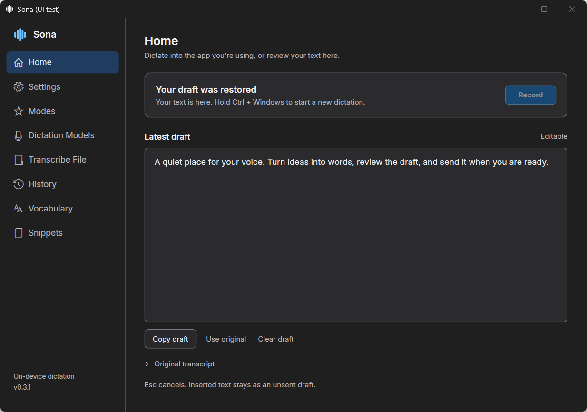
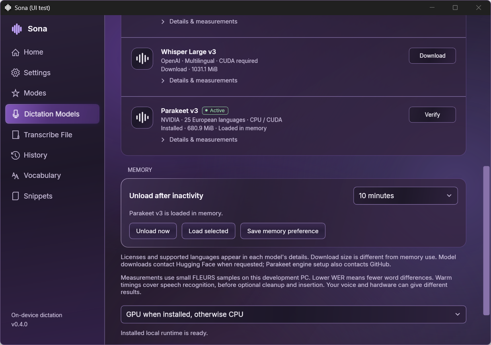

# Sona

**Local voice dictation for Windows, with a draft you stay in control of.**

Speak into a focused text field, review your words, and send them yourself.
Sona runs Whisper on your computer, keeps the selected model warm between
dictations, and can protect your Discord call while you record.

Sona began with a simple frustration: dictation subscriptions and usage limits
can get in the way of an everyday tool. The goal is a quiet Windows app that
uses your own hardware, needs no Sona account, and fits into your writing and
agent workflows. Local dictation already has good alternatives; Sona focuses
on this particular combination of native Windows UI, careful draft insertion,
and call protection. [Compare the approaches](docs/ALTERNATIVES.md).

**Private preview.** Version 0.3.1 has passed source and native fixture checks; live behavior still needs owner testing.
There is no published binary download yet. Source and private packages remain
separate from a public release.



## What Sona does

- **Dictate without submitting.** Hold Ctrl + Windows and release to finish,
  or double-tap the combination to start hands-free recording and tap once to
  stop. This combined mode is called Hold / double-tap; the legacy Toggle mode
  also remains available. Esc cancels. Sona never presses
  Enter to send your message.
- **Keep your draft.** Home has an editable result and its original text.
  Focus changes preserve the draft instead of inserting into a different field.
  Optionally copy completed dictation to the clipboard; this starts off by
  default and can be enabled in Settings.
- **See the recording.** Choose Panel or Capsule, with measured microphone
  levels, elapsed time, stop/cancel controls, and the captured target app name.
- **Choose your local model.** Tiny, Base, Small, Medium, Large v3 Turbo and
  Large v3 are six Whisper profiles, executed by whisper.cpp. Downloads are
  explicit and checked against pinned sizes and hashes. Model selection and
  residency are shown separately.
- **Avoid repeated loading.** One selected model stays resident until unload,
  a model switch, quit, or the idle timeout. The default is 10 minutes;
  Keep until quit is also available.
- **Protect a Discord call.** Optionally mute Discord while Sona or a watched
  app records, with separate incoming-audio protection. Overlapping recordings
  share protection and manual mute/deafen choices are preserved.
- **Make it yours.** Eight original light/dark themes, bundled Inter typography,
  Clean/Verbatim/Notes modes, vocabulary hints, corrections and snippets.
- **Use your tools.** `sona-agent` provides JSON CLI commands and an MCP stdio
  interface for status, validated settings, model management and call protection.
- **Check for updates when you choose.** Optional GitHub update checks run at
  startup and every 12 hours. They need no account and never install automatically.
  An unavailable private release endpoint means no public release is available,
  not that you need to sign in.



## Start from source

You need Windows x64, PowerShell, a microphone for live dictation, and .NET 8
with Windows desktop support. Initial SDK, engine, model and NuGet downloads
need network access. After setup, speech transcription runs locally. CUDA
requires a separate compatible NVIDIA engine installation.

From the repository root, prepare the pinned CPU engine, Small model and SDK:

```powershell
$env:SONA_RUNTIME = Join-Path $env:LOCALAPPDATA 'Sona\runtime'
.\tools\setup-runtime.ps1 -RuntimeRoot $env:SONA_RUNTIME -BuildTools
$env:DOTNET_CLI_HOME = Join-Path $env:SONA_RUNTIME 'dotnet-home'
$env:NUGET_PACKAGES = Join-Path $env:SONA_RUNTIME 'nuget'
$env:DOTNET_CLI_TELEMETRY_OPTOUT = '1'
$sonaDotnet = Join-Path $env:SONA_RUNTIME 'sdk\dotnet.exe'
& $sonaDotnet build .\src\Murmur.App\Murmur.App.csproj -c Release --disable-build-servers -p:UseSharedCompilation=false
& $sonaDotnet build .\src\Sona.Agent\Sona.Agent.csproj -c Release --disable-build-servers -p:UseSharedCompilation=false
& $sonaDotnet run --project .\tests\Murmur.Tests -c Release --disable-build-servers -p:UseSharedCompilation=false
& $sonaDotnet run --project .\tests\Murmur.WindowsTests -c Release --disable-build-servers -p:UseSharedCompilation=false
& $sonaDotnet list .\src\Murmur.App\Murmur.App.csproj package --vulnerable --include-transitive
```

To open the built app in the same PowerShell session:

```powershell
& $sonaDotnet run --project .\src\Murmur.App -c Release --no-build
```

The repository's `tools/build.ps1` and smoke-test helpers use the owner's
`E:\DevelopmentTools\local-dictation` layout. That path is a development
convenience, not a requirement for every Windows machine. Legacy internal
Murmur names preserve source and preference compatibility.

Qualified private packages use `tools/install.ps1`; upgrades use
`tools/upgrade.ps1 -PackageDirectory <package> -ProcessId <Sona PID>` to preserve
an idle app's draft through an encrypted checkpoint. The installer verifies
package files, creates a Start shortcut and stable `sona-agent` user-PATH entry.
Startup is opt in. Engine/model/CUDA files are not bundled in the app package.

## CLI and MCP

```powershell
sona-agent status
sona-agent models list
sona-agent models install tiny
sona-agent protection status
sona-agent settings patch '{"language":"fr","shortcutMode":"Toggle"}'
```

The running app exposes a current-user-only named pipe. `sona-agent --mcp`
serves its named operations over stdio. Credentials, history and starting the
microphone are outside this interface.
[Agent setup and MCP configuration](docs/AGENT-INTERFACE.md).

## Privacy and current limits

No cloud speech provider, BYOK, sign-in, sync, analytics or background audio
upload is implemented. History is memory-only by default; optional local text
saving is capped at 200 entries and stores no audio. Local transcription needs
no Sona subscription and has no subscription word quota, but recordings are
limited to 120 seconds and transcription requests to 90 seconds.

The current Clean/Notes modes use deterministic rules. A separate local language
model cleanup stage has been [benchmarked](docs/CLEANUP-RESEARCH.md), with promising
latency and an observed mixed-language meaning error; it is not integrated yet.

This preview targets Windows only. Medium, Turbo and Large require the
separately installed CUDA engine. File transcription accepts short 16 kHz mono
PCM WAVs. Accuracy and speed depend on the model, hardware, language and audio;
only Small CPU and Turbo CUDA have measured project benchmarks.

Discord protection requires your own authorized Discord developer app/tester
setup or a reviewed Hush import. Sona ships no shared credentials. Pause and
quit Hush before connecting Sona so only one app controls Discord.
Call protection currently supports Discord only; adapters for other call
platforms are future work and are not implemented.

Builds, synthetic replay and native test instances do not establish live
microphone, target-app insertion or real-call acceptance. Current evidence and
remaining checks are in [verification](docs/VERIFICATION.md) and the
[owner test guide](tools/owner-test.md).

[Design](docs/DESIGN.md) · [Implementation](docs/IMPLEMENTATION.md) ·
[Integration plans](docs/INTEGRATED-SONA.md) ·
[Third-party notices](THIRD-PARTY-NOTICES.md)

## License

Sona's source is licensed under [MIT](LICENSE). Third-party engines, models,
fonts and redistributables retain their own terms; see
[third-party notices](THIRD-PARTY-NOTICES.md).
