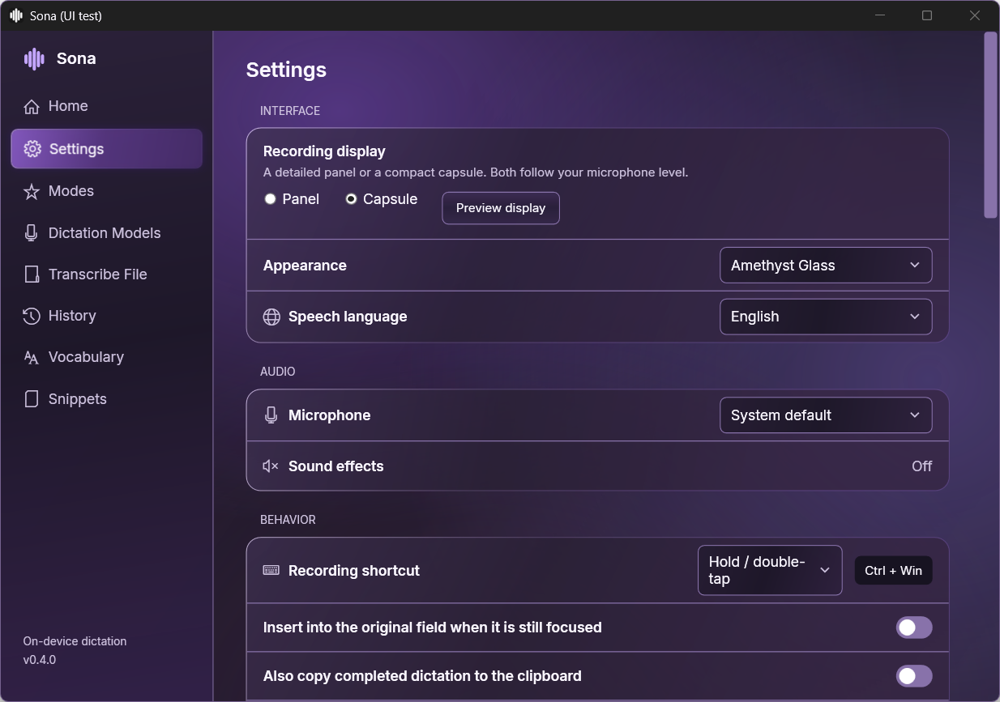

# Sona

**Local voice dictation for Windows. Speak, review the text, and send it yourself.**

Sona turns speech into text in your focused app using Parakeet or Whisper on
your own computer. Keep a model warm for quick reuse, polish wording locally,
add your vocabulary, and mute your Discord microphone while you dictate.
No Sona account or subscription is required.

It started with a frustration: subscriptions and quotas can make an everyday
dictation tool feel harder to use than it should. Sona is an early open-source
attempt at a native Windows alternative that you can inspect, adapt and improve.

**Early preview: 0.4.0.** Build from source below. There is no published binary
download yet. Feedback, bug reports, contributions and feature suggestions are
welcome.


Screenshots use the real 0.4.0 interface with an isolated profile and synthetic text.

## Everyday dictation

- **Hold Ctrl + Windows** to record, then release to finish. Double-tap the
  combination for hands-free recording and tap once to stop. Esc cancels.
  Sona writes into the text field you're using. It never presses Send or Enter
  to submit a message; you review and send it yourself.
- **Keep control of your words.** Home retains the original transcript and an
  editable result. A focus change preserves the draft instead of inserting it
  into a different field. Clipboard backup is optional.
- **Choose local recognition.** NVIDIA Parakeet v3 and six Whisper models
  offer CPU or NVIDIA CUDA options. Explicit downloads use pinned sizes and
  hashes. Selected and actually loaded models are shown separately.
- **Keep models ready.** One speech worker stays resident for the configured
  idle timeout, until a switch, explicit unload or quit. Keep until quit is
  available; unloading keeps the downloads.
- **Polish locally.** Optional Spokenly Cleanup 1 handles punctuation, fillers,
  repetition and spoken corrections with Polished, Casual or Lowercase styles.
  It has separate CPU/GPU and idle controls. Verbatim and exact snippets bypass
  the model; your original transcript remains available.
- **Add your vocabulary.** Recognition hints, corrections and snippets help
  with project names, terminology and recurring text.
- **Keep dictation out of Discord calls.** Optional protection mutes your microphone while
  Sona or a watched ChatGPT/Codex app records, so others do not hear your
  dictation. Incoming audio can also be silenced. Overlapping recordings share
  protection, and restoration respects manual mute/deafen choices.
- **Fit your workspace.** Nine light/dark themes, Inter typography, Panel or
  Capsule recording displays, microphone level bars and local WAV transcription.
- **Connect your tools.** A JSON CLI and stdio MCP interface manage status,
  validated settings, models and call protection without remote microphone control.

Choose **Settings → Appearance → Amethyst Glass** to try layered violet surfaces,
soft illumination and highlighted controls. On supported Windows 11 systems with
transparency enabled, it uses Mica; an opaque material fallback is available.
The existing Amethyst theme and new-profile defaults remain available.




## Build and run

You need Windows x64 and PowerShell. A microphone is needed for live dictation.
Initial SDK, NuGet, engine and model downloads need internet access. The setup
script below provisions the pinned .NET 8 SDK, Whisper CPU engine and Small
model into a directory you choose.

Clone the repository, then run these commands from its root:

```powershell
git clone https://github.com/JhinxDev/Sona.git
cd Sona

$env:SONA_RUNTIME = Join-Path $env:LOCALAPPDATA 'Sona\runtime'
.\tools\setup-runtime.ps1 -RuntimeRoot $env:SONA_RUNTIME -BuildTools
$env:DOTNET_CLI_HOME = Join-Path $env:SONA_RUNTIME 'dotnet-home'
$env:NUGET_PACKAGES = Join-Path $env:SONA_RUNTIME 'nuget'
$env:DOTNET_CLI_TELEMETRY_OPTOUT = '1'
$sonaDotnet = Join-Path $env:SONA_RUNTIME 'sdk\dotnet.exe'

& $sonaDotnet build .\src\Murmur.App\Murmur.App.csproj -c Release --disable-build-servers -p:UseSharedCompilation=false
& $sonaDotnet build .\src\Sona.Agent\Sona.Agent.csproj -c Release --disable-build-servers -p:UseSharedCompilation=false
& .\src\Murmur.App\bin\Release\net8.0-windows\Sona.exe
```

Keep `SONA_RUNTIME` set when launching this source build so Sona finds these
assets. Internal `Murmur` names preserve source and preference compatibility.

In **Dictation Models**, choose **Download** for Parakeet v3, then **Use model**.
Its CPU or CUDA runtime is installed explicitly when needed. For CPU execution,
choose **CPU only** and save model preferences before downloading. CUDA requires a compatible NVIDIA
driver; Sona does not install a driver or global CUDA toolkit. Whisper CUDA
uses a separate setup script:

```powershell
.\tools\setup-cuda-runtime.ps1 -RuntimeRoot $env:SONA_RUNTIME
```

In **Settings → Text cleanup**, set up the selected backend, enable cleanup and
save preferences. See [cleanup setup](docs/LOCAL-CLEANUP.md) and
[model details](docs/PARAKEET.md).

## CLI and MCP

With Sona running, use the CLI built above:

```powershell
$sonaAgent = '.\src\Sona.Agent\bin\Release\net8.0-windows\sona-agent.exe'
& $sonaAgent status
& $sonaAgent models list
& $sonaAgent cleanup status
& $sonaAgent protection status
```

Use the absolute path of `sona-agent.exe` with `--mcp` in an MCP-capable client.
The desktop connection is a current-user-only named pipe; MCP runs over stdio.
The interface does not expose credentials, transcript export or microphone-start
  commands. [Commands and MCP configuration](docs/AGENT-INTERFACE.md).

## Privacy and preview limits

Speech recognition and text cleanup run locally. Model/runtime downloads,
optional GitHub update checks and an enabled Discord connection use the network.
Cloud speech, sign-in, sync and analytics are not implemented.

Startup, saved transcript history, clipboard backup, local model cleanup,
Discord protection and update checking start disabled on new profiles.
Optional local history is capped at 200 text entries and stores no audio.

Recordings are bounded to 120 seconds and speech requests to 90 seconds.
Long Parakeet recordings use independent segments of at most 25 seconds.
File transcription accepts short 16 kHz mono PCM WAVs. Medium, Turbo and Large
Whisper require the separately installed CUDA engine. Cleanup is limited to
4000 input characters and a 20-second inference deadline; model loading has
separate limits. Cleanup can change meaning despite preservation checks, so
review your result and use the original when needed.

On one RTX 4080 SUPER, eight English clips gave Parakeet v3 5.13% word error
rate and a 21 ms median warm speech request, versus Whisper Turbo's 5.77% and
144 ms. This small licensed fixture excludes recording, cleanup and insertion;
it does not predict your voice or end-to-end delay. The pinned Whisper CUDA
runtime also crashed in a mixed English/French resident sequence. Personal
microphone and target-app acceptance for the new Parakeet integration remain
open. [Measurements and known limits](docs/PARAKEET.md).

Discord protection currently supports Discord only and requires your own
authorized Discord developer application setup. Sona ships no shared credentials.
Connect and enable it in Settings. If another app controls Discord muting, pause
that app first so both do not change the same call state.

## Contributing

Try it on your hardware and tell us what works, what fails, and what would make
dictation more useful. Include your Windows version, selected model/backend and
steps to reproduce a bug. Keep private transcripts and credentials out of reports.

For the maintained regression checks, from the same PowerShell session:

```powershell
& $sonaDotnet run --project .\tests\Murmur.Tests -c Release --disable-build-servers -p:UseSharedCompilation=false
& $sonaDotnet run --project .\tests\Murmur.WindowsTests -c Release --disable-build-servers -p:UseSharedCompilation=false
```

These checks do not establish real microphone, target-app insertion or call
acceptance. [Preview validation](docs/PREVIEW-VALIDATION.md) ·
[Contributing](CONTRIBUTING.md) · [Verification](docs/VERIFICATION.md) ·
[Design](docs/DESIGN.md) · [Implementation](docs/IMPLEMENTATION.md) ·
[Alternatives](docs/ALTERNATIVES.md)

## License

Sona's original source is [MIT licensed](LICENSE). Engines, models, fonts and
redistributables retain their own terms, including Parakeet's CC-BY-4.0 weights.
The bundled Parakeet scheduler repair includes its source patch, rebuild
instructions and license notices. [Third-party notices](THIRD-PARTY-NOTICES.md).
